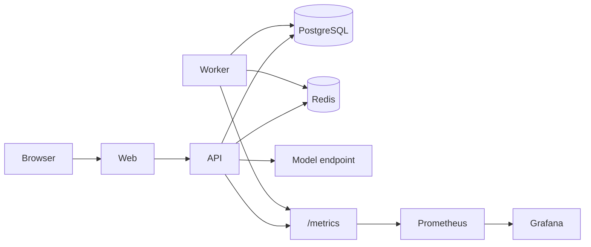

# Leaflet

Leaflet is a campaign desk for a small business. It keeps campaigns, a short audience list, drafted social posts and emails, and a queue of scheduled posts.

Drafts go to an OpenAI-compatible `/chat/completions` endpoint when `LLM_BASE_URL` is set. With no endpoint, the API uses a deterministic local writer, so the app runs without a key.

Dispatch does not call a social network. The worker locks a due row in Redis, logs the send, and marks the post sent in Postgres. Postgres is the queue. Redis only keeps two workers from taking the same row.

## Architecture



The model endpoint is optional. The web container proxies `/api` to the API, so the browser stays on one origin.

## Quickstart

Docker Compose is the short path.

```sh
cp .env.example .env
docker compose up --build
```

Open http://localhost:8080. The API is on http://localhost:8000 and the OpenAPI document is at `/docs`. `SEED_DEMO=true` loads a bakery campaign, four contacts, and one future post.

To scrape metrics locally:

```sh
docker compose --profile obs up --build
```

Prometheus is on http://localhost:9090. Grafana is on http://localhost:3000 with anonymous read access, which is only meant for this local profile. The dashboard is `deploy/grafana/leaflet.json`.

Without Docker, install the API and use SQLite:

```sh
python3 -m venv .venv
. .venv/bin/activate
pip install -e "./backend[dev]"
make run
```

In another shell, `npm --prefix frontend install` and `npm --prefix frontend run dev`. Vite proxies `/api` to port 8000.

## Configuration

| Variable | Purpose |
| --- | --- |
| `DATABASE_URL` | SQLAlchemy URL. Compose points this at Postgres. |
| `REDIS_URL` | Required for the worker. The API can schedule posts without it. |
| `LLM_BASE_URL` | OpenAI-compatible base URL, for example `https://api.openai.com/v1`. Empty uses the local writer. |
| `LLM_API_KEY` | Sent as a bearer token when set. |
| `LLM_MODEL` | Model name passed through to the endpoint. Default `gpt-4o-mini`. |
| `SEED_DEMO` | Load the sample shop when the campaign table is empty. |
| `AUTO_CREATE_SCHEMA` | Create tables on startup. Compose uses Alembic instead. |
| `RUN_MIGRATIONS` | `1` makes the API container run `alembic upgrade head` before serving. |
| `CORS_ORIGINS` | Comma-separated browser origins for direct API calls. |

## Tests

```sh
make lint
make test
```

The tests use SQLite and do not need Postgres, Redis, or a model key.

## Deploy

The Helm chart is `deploy/helm/leaflet`. It sets probes, requests and limits, an HPA on the API, a pod disruption budget, a default-deny NetworkPolicy with DNS, Postgres, Redis, and model egress, and an ExternalSecret that stays off until `externalSecrets.enabled=true`.

Create the env secret first when the operator is not installed. It needs `DATABASE_URL`, `REDIS_URL`, and `LLM_API_KEY` (the last one may be empty).

```sh
helm lint deploy/helm/leaflet
helm upgrade --install leaflet deploy/helm/leaflet --namespace leaflet --create-namespace
```

API and worker pods expose `/metrics`. The chart annotates them for Prometheus.

`terraform/aws` is an example VPC, EKS cluster, private RDS Postgres, and ElastiCache Redis. It has no remote backend. Add one before sharing state. Pass the database password out of band.

```sh
cd terraform/aws
terraform init
terraform plan -var-file=envs/example.tfvars -var="db_password=..."
```

Check the EKS and RDS engine versions against what the region currently offers. The database security groups allow the VPC CIDR so the example does not need a custom node launch template. Narrow that to the node security group before production. `db_skip_final_snapshot` defaults to true so the example can be destroyed.

Images are built from `backend/Dockerfile` and `frontend/Dockerfile`. Both run as non-root.

## Layout

```
backend/                 FastAPI app, worker, Alembic migration, pytest
frontend/                Vite React UI
deploy/helm/leaflet/     chart
deploy/grafana/          dashboard JSON and local provisioning
deploy/prometheus/       scrape config for the compose obs profile
terraform/aws/           example EKS, RDS, and Redis
.github/workflows/ci.yml ruff, pytest, frontend build, image build, Trivy, helm lint
```

CI runs on push and does not need repository secrets. Trivy reports critical findings and does not fail the job, because base-image advisories move independently of this repo.

## License

MIT. See [LICENSE](LICENSE).
